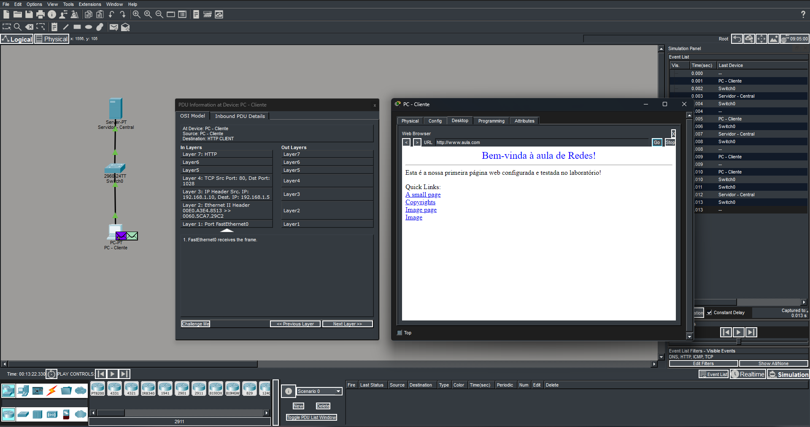

# Laboratório 02 — Configuração de HTTP e DNS

## Objetivo

Este laboratório teve como objetivo construir uma rede funcional, configurar os serviços de aplicação e testar a camada de transporte utilizando o Cisco Packet Tracer.

A atividade envolveu a configuração de endereços IP, a ativação dos serviços HTTP, HTTPS e DNS, a realização de testes de conectividade e a análise dos protocolos envolvidos na comunicação por meio do modo Simulation.

## O que são os serviços DNS e HTTP?

O **DNS (Domain Name System)** é responsável por traduzir nomes de domínio, como `www.aula.com`, em endereços IP, permitindo que os dispositivos localizem os servidores sem que seja necessário memorizar seus endereços IP.

O **HTTP (Hypertext Transfer Protocol)** é um protocolo da camada de aplicação utilizado na comunicação entre clientes e servidores web. Ele permite que um navegador solicite páginas e que o servidor retorne o conteúdo solicitado. O **HTTPS** utiliza mecanismos de segurança baseados em TLS para proteger a comunicação.

A configuração desses serviços permite compreender como os protocolos trabalham em conjunto para que um cliente consiga acessar uma página web utilizando um nome de domínio.

## Topologia da rede

A topologia foi construída utilizando um switch, um computador cliente e um servidor central.

- **1 switch Cisco 2960**
- **1 PC — PC-Cliente**
- **1 servidor — Servidor-Central**

Os dispositivos foram conectados ao switch utilizando cabos diretos (*Straight-Through*).

## Endereçamento IP

Os dispositivos foram configurados com endereços IP pertencentes à rede `192.168.1.0/24`.

| Dispositivo | Endereço IP | Máscara de sub-rede |
|---|---|---|
| PC-Cliente | 192.168.1.5 | 255.255.255.0 |
| Servidor-Central | 192.168.1.10 | 255.255.255.0 |

No PC-Cliente, o endereço `192.168.1.10` foi configurado como servidor DNS.

## Configuração dos serviços

### Servidor HTTP e HTTPS

No Servidor-Central, foram ativados os serviços HTTP e HTTPS na aba **Services > HTTP**.

O arquivo `index.html` também foi personalizado para exibir uma mensagem de boas-vindas:

> Bem-vinda à aula de Redes!

O conteúdo da página foi alterado para apresentar uma mensagem personalizada durante o acesso pelo navegador do PC-Cliente.

### Servidor DNS

O serviço DNS foi ativado no Servidor-Central e configurado com o seguinte registro:

| Nome | Endereço IP |
|---|---|
| www.aula.com | 192.168.1.10 |

Dessa forma, o nome `www.aula.com` passou a apontar para o endereço IP do servidor web.

## Testes de conectividade e resolução de nomes

Após as configurações, foram realizados testes no PC-Cliente por meio do **Command Prompt**.

### Teste 1 — Conectividade com o servidor

Foi utilizado o comando `ping` para verificar a comunicação entre o cliente e o servidor:

```text
ping 192.168.1.10
```

O teste permitiu verificar se o PC-Cliente conseguia alcançar o Servidor-Central por meio da rede.

### Teste 2 — Resolução DNS

Em seguida, foi utilizado o comando `nslookup` para consultar o endereço IP associado ao nome de domínio configurado:

```text
nslookup www.aula.com
```

O resultado esperado era a resolução de `www.aula.com` para o endereço `192.168.1.10`.

### Teste 3 — Acesso à página web

No navegador do PC-Cliente, foi acessado o endereço:

`http://www.aula.com`

O teste permitiu verificar o funcionamento conjunto do serviço DNS, responsável pela resolução do nome, e do serviço HTTP, responsável pela entrega da página web.

## Simulação de protocolos

Foi utilizado o modo **Simulation** do Cisco Packet Tracer para acompanhar as etapas da comunicação entre o PC-Cliente e o Servidor-Central.

Foram selecionados os filtros dos protocolos ICMP, DNS, TCP e HTTP, permitindo observar os pacotes gerados durante os testes e o acesso à página web.

A análise das informações das PDUs permitiu observar os protocolos envolvidos e compreender como as camadas de transporte e aplicação participam da comunicação entre cliente e servidor.

## Resultado


