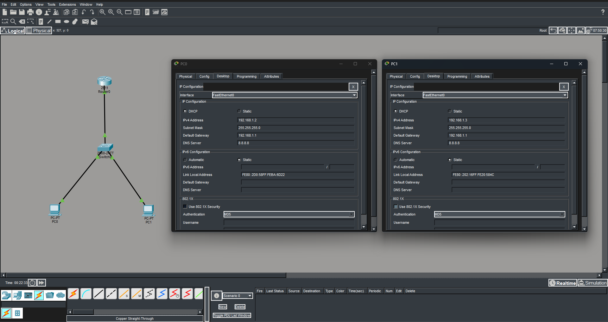

# Laboratório 4 — Configuração de DHCP em um Roteador

## Objetivo do Projeto

Configurar um roteador Cisco para atuar como servidor DHCP (*Dynamic Host Configuration Protocol*), distribuindo automaticamente os parâmetros de rede aos computadores conectados à rede local.

A atividade tem como objetivo praticar a configuração de interfaces de rede pela CLI (*Command-Line Interface*), a criação de um pool DHCP e a validação da atribuição automática de endereços IP.

## Cenário Proposto

O cenário simula uma pequena rede local composta por um roteador, um switch e dois computadores. O roteador é responsável por atuar como gateway da rede e fornecer as configurações de rede aos dispositivos por meio do serviço DHCP.

**Dispositivos utilizados:**

- 1 roteador Cisco 2911;
- 1 switch Cisco 2960;
- 2 computadores PC-PT;
- Cabos Copper Straight-Through para as conexões cabeadas.

## ⚙️ Etapas de Configuração

### 1. Montagem da Topologia

Os dispositivos foram adicionados à área de trabalho do Cisco Packet Tracer e conectados utilizando cabos Copper Straight-Through.

As conexões foram realizadas da seguinte forma:

- PC0 conectado a uma porta FastEthernet do switch;
- PC1 conectado a outra porta FastEthernet do switch;
- Switch conectado à interface GigabitEthernet0/0 do roteador.

### 2. Configuração da Interface do Roteador

A interface GigabitEthernet0/0 foi configurada com o endereço IP `192.168.1.1`, que será utilizado como gateway padrão pelos computadores da rede.

Comandos executados na CLI:

```text
enable
configure terminal
interface GigabitEthernet0/0
ip address 192.168.1.1 255.255.255.0
no shutdown
exit
```

O comando `no shutdown` ativa administrativamente a interface, permitindo a comunicação pela porta, desde que as demais condições da conexão estejam corretas.

### 3. Configuração do Pool DHCP

Foi criado um pool DHCP denominado `MULHER_DIGITAL2026`, responsável por distribuir os parâmetros de rede aos computadores.

```text
ip dhcp pool MULHER_DIGITAL2026
network 192.168.1.0 255.255.255.0
default-router 192.168.1.1
dns-server 8.8.8.8
exit
```

Os parâmetros configurados foram:

| Parâmetro | Valor |
|---|---|
| Nome do pool | `MULHER_DIGITAL2026` |
| Rede | `192.168.1.0/24` |
| Máscara de sub-rede | `255.255.255.0` |
| Gateway padrão | `192.168.1.1` |
| Servidor DNS | `8.8.8.8` |

O roteador utilizará essas informações para fornecer configurações IPv4 aos dispositivos que solicitarem um endereço por DHCP.

### 4. Salvamento da Configuração

Após concluir as configurações, foram executados os comandos abaixo:

```text
exit
write
```

O comando `write` salva a configuração em execução na configuração de inicialização, permitindo que ela seja preservada após a reinicialização do roteador.

### 5. Configuração dos Computadores

Nos computadores PC0 e PC1, foi acessada a opção **Desktop > IP Configuration** e selecionada a opção **DHCP**.

Após a solicitação, cada computador recebeu automaticamente os parâmetros fornecidos pelo roteador.

Os endereços esperados são:

| Parâmetro | PC0 | PC1 |
|---|---|---|
| Endereço IP | `192.168.1.2` | `192.168.1.3` |
| Máscara de sub-rede | `255.255.255.0` | `255.255.255.0` |
| Gateway padrão | `192.168.1.1` | `192.168.1.1` |
| Servidor DNS | `8.8.8.8` | `8.8.8.8` |

## 🧪 Testes e Validação

Para verificar se o serviço DHCP está funcionando corretamente, foram previstos os seguintes testes:

**1. Verificação dos parâmetros de rede**

Nos computadores, acessar **Desktop > IP Configuration** e confirmar se o endereço IP, a máscara de sub-rede, o gateway e o DNS foram preenchidos automaticamente.

**2. Verificação pelo terminal**

No Command Prompt do PC0, executar:

```text
ipconfig
```

O comando permite consultar os parâmetros de rede recebidos pelo computador.

**3. Teste de conectividade com o gateway**

Executar no PC0:

```text
ping 192.168.1.1
```

O recebimento de respostas indica que o computador consegue se comunicar com a interface do roteador.

## Resultado




A atividade reforçou conceitos fundamentais de endereçamento IPv4, configuração de dispositivos de rede pela CLI e validação da conectividade entre computadores e gateway.

