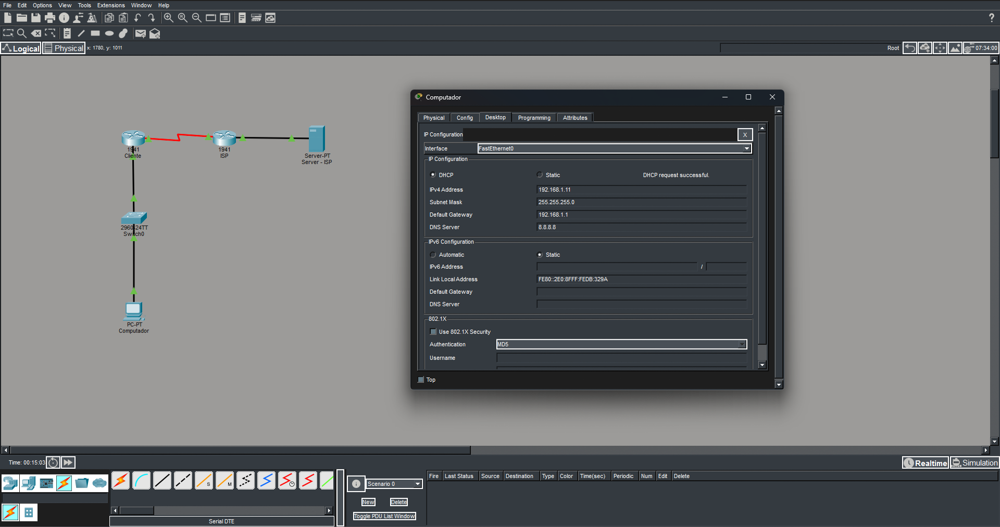
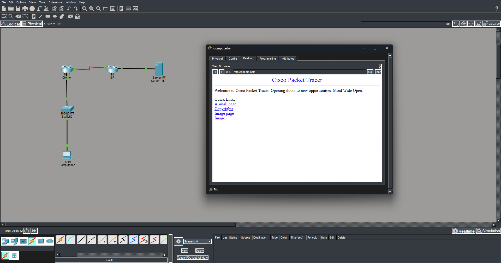

# Laboratório 5 — Configuração de LAN e ISP

## Objetivo

Construir e configurar uma rede local (LAN) conectada a um provedor de serviços de Internet (ISP), utilizando o Cisco Packet Tracer.

O laboratório tem como objetivo praticar a configuração de endereços IPv4, a distribuição automática de endereços por DHCP, a resolução de nomes por DNS, o roteamento entre redes e a tradução de endereços de rede por NAT. Ao final, será realizado um teste de navegação para verificar a comunicação entre o computador da rede local e o servidor que simula um serviço externo.

## O que é LAN e ISP?

### LAN — Local Area Network

LAN (*Local Area Network*), ou rede local, é uma rede que conecta dispositivos em uma área limitada, como uma residência, um escritório ou uma empresa.

Neste laboratório, a LAN é formada pelo computador PC0, pelo switch Switch-01 e pelo roteador Router-Cliente. O roteador funciona como gateway da rede e fornece endereços IP automaticamente aos dispositivos por meio do DHCP.

### ISP — Internet Service Provider

ISP (*Internet Service Provider*), ou provedor de serviços de Internet, é uma empresa que oferece acesso à Internet e outros serviços de conectividade.

No cenário simulado, o Router-ISP e o Server-ISP representam a infraestrutura do provedor. O servidor disponibiliza um serviço DNS e uma página web para permitir os testes de resolução de nomes e navegação.

## Dispositivos

- 1 computador PC-PT, renomeado para PC0;
- 1 switch Cisco 2960, renomeado para Switch-01;
- 1 roteador Cisco 1941, renomeado para Router-Cliente;
- 1 roteador Cisco 1941, renomeado para Router-ISP;
- 1 servidor Server-PT, renomeado para Server-ISP;
- 2 módulos seriais HWIC-2T, um para cada roteador;
- Cabos Copper Straight-Through e cabo serial DCE.

## Conexões

Antes de realizar as conexões, foi necessário desligar cada roteador Cisco 1941, instalar o módulo HWIC-2T e ligá-lo novamente.

As conexões foram realizadas da seguinte forma:

- PC0 conectado à porta FastEthernet0/1 do Switch-01;
- Switch-01 conectado à interface GigabitEthernet0/0 do Router-Cliente;
- Router-Cliente conectado ao Router-ISP por meio das interfaces Serial0/0/0;
- Router-ISP conectado ao Server-ISP por meio das interfaces GigabitEthernet0/0 e FastEthernet0, respectivamente.

## Configuração do Servidor do ISP

O Server-ISP foi configurado com endereço IP estático para disponibilizar os serviços utilizados no laboratório.

| Parâmetro | Valor |
|---|---|
| Endereço IPv4 | `8.8.8.8` |
| Máscara de sub-rede | `255.255.255.0` |
| Gateway padrão | `8.8.8.1` |
| Servidor DNS | `8.8.8.8` |

Em seguida, o serviço DNS foi ativado na aba **Services > DNS**, com o seguinte registro:

| Campo | Valor |
|---|---|
| Nome | `google.com` |
| Endereço | `8.8.8.8` |

Esse registro permite que o nome `google.com` seja resolvido para o endereço IP do servidor simulado.

Para que o navegador consiga exibir a página, o serviço HTTP do servidor também foi habilitado.

## Configuração do Router-ISP

O roteador do provedor foi configurado com endereços IP nas interfaces Ethernet e serial, permitindo a comunicação com o servidor e com o roteador do cliente.

Comandos executados na CLI:

```text
enable
configure terminal

interface GigabitEthernet0/0
ip address 8.8.8.1 255.255.255.0
no shutdown
exit

interface Serial0/0/0
ip address 200.1.1.2 255.255.255.252
no shutdown
exit

ip route 200.1.1.0 255.255.255.252 200.1.1.1

end
write memory
```

A interface GigabitEthernet0/0 funciona como gateway do Server-ISP, enquanto a interface serial estabelece a comunicação com o Router-Cliente.

## Configuração do Router-Cliente

O roteador do cliente foi configurado para atuar como gateway da LAN, servidor DHCP e dispositivo responsável pela tradução de endereços de rede por NAT.

### Configuração das interfaces

```text
enable
configure terminal

interface GigabitEthernet0/0
ip address 192.168.1.1 255.255.255.0
ip nat inside
no shutdown
exit

interface Serial0/0/0
ip address 200.1.1.1 255.255.255.252
ip nat outside
clock rate 64000
no shutdown
exit
```

A interface GigabitEthernet0/0 foi definida como interface interna da rede, enquanto a Serial0/0/0 foi definida como interface externa para a comunicação com o ISP.

O comando `clock rate 64000` fornece temporização para o enlace serial quando essa interface está no lado DCE.

### Configuração do DHCP

```text
ip dhcp excluded-address 192.168.1.1 192.168.1.10

ip dhcp pool REDE_LOCAL
network 192.168.1.0 255.255.255.0
default-router 192.168.1.1
dns-server 8.8.8.8
exit
```

O pool `REDE_LOCAL` define os parâmetros que serão distribuídos automaticamente aos dispositivos da LAN.

Os endereços de `192.168.1.1` a `192.168.1.10` foram excluídos da distribuição, reservando essa faixa para uso manual. Dessa forma, o primeiro endereço disponível para concessão DHCP será normalmente `192.168.1.11`.

### Configuração do roteamento

```text
ip route 0.0.0.0 0.0.0.0 200.1.1.2
```

A rota padrão indica que os pacotes destinados a redes desconhecidas devem ser encaminhados ao endereço `200.1.1.2`, pertencente ao Router-ISP.

### Configuração do NAT Overload

```text
access-list 1 permit 192.168.1.0 0.0.0.255

ip nat inside source list 1 interface Serial0/0/0 overload

end
write memory
```

A lista de acesso identifica os endereços da LAN autorizados a utilizar a tradução. O NAT Overload, também conhecido como PAT (*Port Address Translation*), permite que os dispositivos da rede local utilizem o endereço da interface serial do roteador para se comunicar com redes externas, diferenciando as sessões por meio das portas.

## Configuração do PC0 por DHCP

No PC0, foi acessada a opção **Desktop > IP Configuration** e selecionada a opção **DHCP**.

Após a solicitação, o computador recebeu automaticamente os seguintes parâmetros:

| Parâmetro | Valor esperado |
|---|---|
| Endereço IPv4 | `192.168.1.11` ou outro endereço disponível |
| Máscara de sub-rede | `255.255.255.0` |
| Gateway padrão | `192.168.1.1` |
| Servidor DNS | `8.8.8.8` |

A mensagem de sucesso da solicitação DHCP indica que o computador recebeu uma configuração automática do Router-Cliente.

## Teste de DNS e Navegação

Para validar o funcionamento dos serviços, foi utilizado o navegador Web Browser disponível na aba **Desktop** do PC0.

No campo de endereço, foi digitado:

```text
google.com
```

Ao clicar em **Go**, o computador deverá consultar o servidor DNS configurado, obter o endereço IP correspondente e tentar acessar a página web do Server-ISP.

O carregamento bem-sucedido da página demonstra o funcionamento integrado da resolução de nomes e da comunicação entre a LAN e o servidor externo, passando pelo gateway e pelo NAT.

## Resultados






